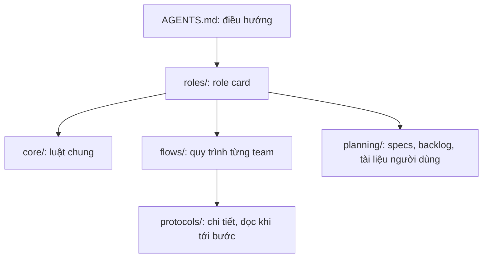

# Kiến trúc agents-kit

Mô tả cách kit được tổ chức và quy ước khi sửa kit. Đọc file này trước khi thêm hoặc sửa hướng dẫn.

## Bốn tầng

| Tầng | Thư mục | Ai đọc | Khi nào |
| --- | --- | --- | --- |
| 1. Điều hướng | `AGENTS.md` | Mọi agent | Luôn |
| 2. Role card | `roles/` | Đúng một role | Luôn |
| 3a. Luật chung | `core/` | Theo danh sách trong role card | Luôn hoặc khi nhận việc |
| 3b. Flow | `flows/` | Role thuộc team đó | Khi làm việc của team |
| 3c. Planning | `planning/` | Chủ yếu PM | Khi lập kế hoạch, đối soát |
| 4. Protocol | `protocols/` | Người gửi việc, PM | Chỉ khi tới đúng bước |

## Bản đồ file

| File | Trách nhiệm duy nhất |
| --- | --- |
| `core/WORKING.md` | Luật làm việc, trung thực, quyền, Git cho mọi role |
| `core/GLOSSARY.md` | Định nghĩa thuật ngữ |
| `core/HANDOFF.md` | Phía nhận việc: snapshot, ack, result, retry |
| `core/MEMORY.md` | Ba tầng memory, đọc, ghi, nén |
| `core/CONFLICTS.md` | Báo và xử lý mâu thuẫn tài liệu |
| `flows/CODE.md` | Flow team code và quy tắc review |
| `flows/CODE-STANDARDS.md` | SRP, contract, giới hạn 250 dòng |
| `flows/MARKETING.md` | Flow marketing, nguồn và độ mới |
| `flows/COUNCIL.md` | Flow hội đồng, registry, độc lập |
| `flows/QA.md` | QA, suite, release gate |
| `planning/PLANNING.md` | Năm file specs, phase/sprint/story, ba cổng |
| `planning/BACKLOG.md` | Theo dõi việc còn mở |
| `planning/USER-DOCS.md` | Tài liệu cho người dùng |
| `protocols/DISPATCH.md` | Phía gửi việc, mode auto/prompt, trả về PM owner |
| `protocols/CONFIG.md` | Schema và kiểm tra `config.json` |
| `protocols/SPRINT-CLOSURE.md` | Đóng sprint, commit |
| `protocols/GIT-RECOVERY.md` | Khôi phục khi commit bị gián đoạn |

Thư mục dữ liệu: `specs/` (quyết định sản phẩm), `memory/` (memory từng role), `templates/` (mẫu), `user/` (tài liệu người dùng và `dashboard/` do PM trực tiếp cập nhật cả dữ liệu lẫn code), `handoffs/` (request, ack, result sinh ra lúc chạy).

## Đọc gì theo role (ước lượng)

| Role | Bắt buộc đọc |
| --- | --- |
| Coder | AGENTS, coder, WORKING, HANDOFF, CODE-STANDARDS |
| Code / UX-UI Reviewer | AGENTS, card, WORKING, HANDOFF, CODE (một section) |
| Member marketing | AGENTS, card, WORKING, HANDOFF, MARKETING |
| Specialist / User persona | AGENTS, card, COUNCIL (một section), HANDOFF, MEMORY |
| Lead | AGENTS, card, WORKING, flow của team, DISPATCH khi gửi việc |
| PM | AGENTS, pm, WORKING, backlog index; các file khác theo bước |

## Quy ước khi sửa kit

1. **Mỗi luật chỉ ở một file.** File khác link tới, không chép lại. Trước khi thêm luật, tìm xem đã có chưa.
2. **Role card ≤ 45 dòng**, có các mục: mô tả một câu → Đọc → Các bước → (Đầu ra) → Không.
3. **Mỗi gạch đầu dòng một ý**, khoảng ≤ 25 từ. Không viết đoạn dài, không ghép nhiều ý bằng dấu `/`.
4. **Viết câu khẳng định.** Điều cấm gom vào mục "Không" ở cuối.
5. **Thuật ngữ mới** thêm vào `core/GLOSSARY.md`.
6. **Chi tiết cho tình huống hiếm** đặt trong `protocols/`, không đưa vào role card hay core.
7. **Không ghi lịch sử xây kit** vào memory, specs, backlog hay handoff mẫu.
8. Sau khi sửa: kiểm link, JSON, encoding UTF-8 và độ dài role card.
